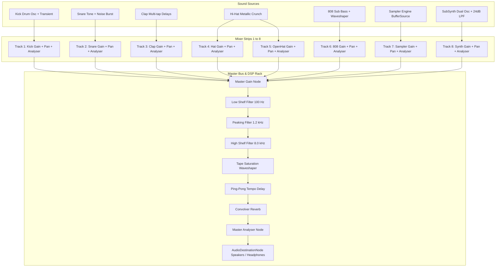

# 🏗️ BeatFlow Studio - Architecture & Engineering Document

This document describes the internal engineering, WebAudio routing graph, scheduling math, DSP algorithms, and persistence models of **BeatFlow Studio**.

---

## 1. The Audio Routing Graph

BeatFlow utilizes the standard W3C Web Audio API running at a constant 48,000 Hz sample rate with low-latency interactive processing.



---

## 2. High-Precision Lookahead Scheduling

JavaScript's `setInterval` and `requestAnimationFrame` are notorious for timing jitter caused by main-thread DOM reflows and garbage collection. To achieve rock-solid musical timing, BeatFlow implements Chris Wilson's **Lookahead Clock Algorithm**:

1. **Clock Interval (`lookaheadMs = 25ms`)**: A lightweight timer runs every 25ms.
2. **Scheduling Horizon (`scheduleAheadTime = 100ms`)**: Notes are scheduled ahead in time directly on WebAudio nodes using the hardware clock (`AudioContext.currentTime`).
3. **Advance Step Equation**:
   $$\Delta t_{16\text{th}} = \frac{60}{\text{BPM} \times 4}$$
   $$\text{Swing Offset} = \begin{cases} \Delta t_{16\text{th}} \times \text{Swing} \times 0.33 & \text{if step is odd} \\ 0 & \text{if step is even} \end{cases}$$
   $$\text{Time}_{\text{next}} = \text{Time}_{\text{current}} + \Delta t_{16\text{th}} + \text{Swing Offset}$$

---

## 3. Sampling Engine & Pitch Shifting Math

### Real-Time Resampling Formula
To transpose an audio slice by $\Delta \text{semitones}$ without audio artifacts or aliasing, BeatFlow scales the `playbackRate` of the `AudioBufferSourceNode`:

$$\text{Rate} = 2^{\frac{\Delta \text{semitones}}{12}}$$

### Anti-Click Micro-Envelopes
When slicing audio at arbitrary points, waveforms frequently cut across non-zero voltages, producing severe audible clicks (DC offset transients). BeatFlow applies an automatic micro-envelope:
- **Fade-in**: 8ms linear ramp from $0.001$ to target velocity.
- **Fade-out**: 8ms linear ramp down to $0.0001$ before buffer disconnection.

### Reverse Buffer Generation
Reversing audio requires an inverted buffer to preserve real-time non-destructive playback. BeatFlow creates a twin `AudioBuffer` and reverses the channel arrays in $O(N)$ time per audio load.

---

## 4. Master DSP Rack Math

### Tape Saturation Waveshaping
To emulate warm analog tape and tube clipping, BeatFlow evaluates an algebraic transfer function:

$$f(x) = \frac{(3 + k) \cdot x \cdot 20^\circ}{\pi + k \cdot |x|}$$

where $k$ represents the saturation drive factor.

### Algorithmic Reverb Impulse Synthesis
The convolver reverb dynamically generates an exponential decay impulse response:

$$h(t) = \text{noise}(t) \cdot e^{-\frac{t}{\tau}}$$

where $\tau$ governs the decay time constant.

---

## 5. Offline Lossless WAV Encoder

The exporter creates an `OfflineAudioContext(2, totalFrames, 48000)`, schedules all pattern events, triggers the rendering pass at maximum CPU throughput (typically 10x-20x real-time), and generates a 44-byte standard RIFF header:

```
[0..3]   "RIFF"
[4..7]   Total Chunk Size (36 + data size)
[8..11]  "WAVE"
[12..15] "fmt "
[16..19] 16 (Subchunk1Size for PCM)
[20..21] 1 (AudioFormat = PCM)
[22..23] 2 (NumChannels = Stereo)
[24..27] 48000 (SampleRate)
[28..31] 192000 (ByteRate = SampleRate * NumChannels * BitsPerSample / 8)
[32..33] 4 (BlockAlign = NumChannels * BitsPerSample / 8)
[34..35] 16 (BitsPerSample)
[36..39] "data"
[40..43] Data Byte Length
[44..N]  16-bit signed interleaved PCM samples [-32768, 32767]
```

This ensures compatibility with all professional media players and DAWs worldwide.
